<p>
<picture>
  <source media="(prefers-color-scheme: light)" srcset="assets/banner/hero-v2-light.svg">
  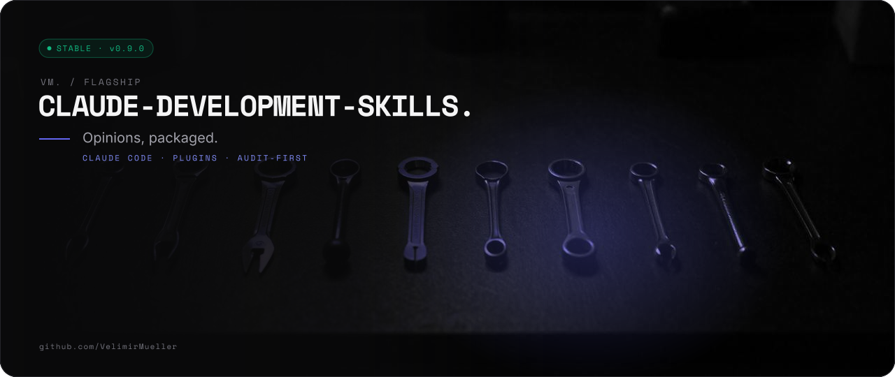
</picture>
</p>

<p>
<picture>
  <source media="(prefers-color-scheme: light)" srcset="assets/readme/lead-v2-light.svg">
  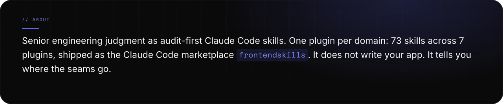
</picture>
</p>

<p>
<picture>
  <source media="(prefers-color-scheme: light)" srcset="assets/readme/stats-v2-light.svg">
  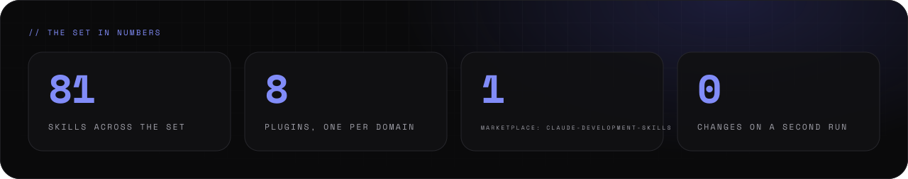
</picture>
</p>

<br>

<p>

</p>

<p>
<picture>
  <source media="(prefers-color-scheme: light)" srcset="assets/readme/features-v2-light.svg">
  
</picture>
</p>

<p>
<picture>
  <source media="(prefers-color-scheme: light)" srcset="assets/readme/what-v2-light.svg">
  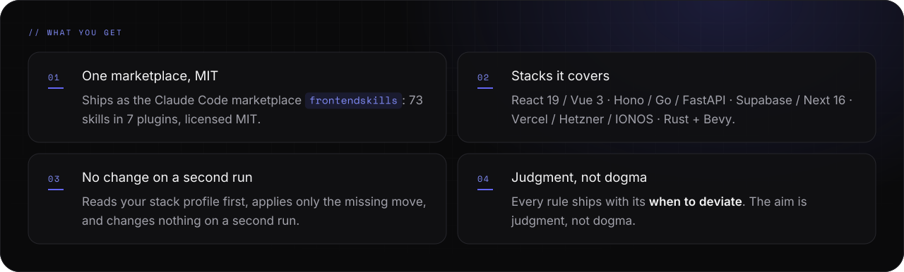
</picture>
</p>

<br>

<p>

</p>

<p>
<picture>
  <source media="(prefers-color-scheme: light)" srcset="assets/readme/start-v2-light.svg">
  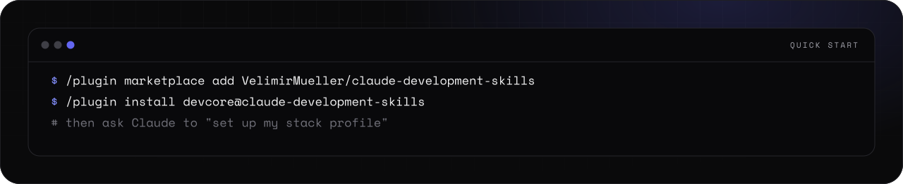
</picture>
</p>

<details>
<summary><picture><source media="(prefers-color-scheme: light)" srcset="assets/readme/links-16-v2-light.svg"></picture></summary>

```text
/plugin marketplace add VelimirMueller/ai-development-skills
/plugin install devcore@ai-development-skills
/plugin marketplace update ai-development-skills
```

</details>

<p>
<picture>
  <source media="(prefers-color-scheme: light)" srcset="assets/readme/setup-v2-light.svg">
  
</picture>
</p>

<br>

<p>

</p>

<p>
<picture>
  <source media="(prefers-color-scheme: light)" srcset="assets/readme/flow-v2-light.svg">
  
</picture>
</p>

<p>
<picture>
  <source media="(prefers-color-scheme: light)" srcset="assets/readme/anatomy-v2-light.svg">
  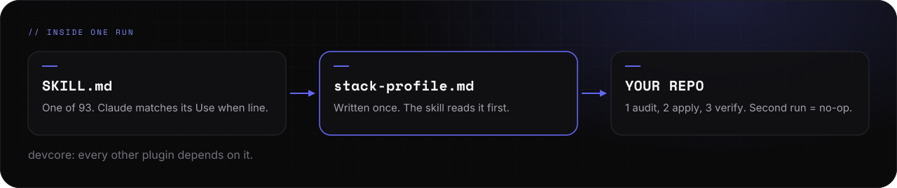
</picture>
</p>

<p>
<picture>
  <source media="(prefers-color-scheme: light)" srcset="assets/readme/how-v2-light.svg">
  
</picture>
</p>

<br>

<p>
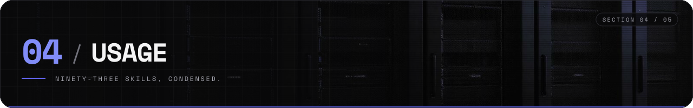
</p>

<p>
<picture>
  <source media="(prefers-color-scheme: light)" srcset="assets/readme/plugins-v2-light.svg">
  
</picture>
</p>

<p>
<picture>
  <source media="(prefers-color-scheme: light)" srcset="assets/readme/team-v2-light.svg">
  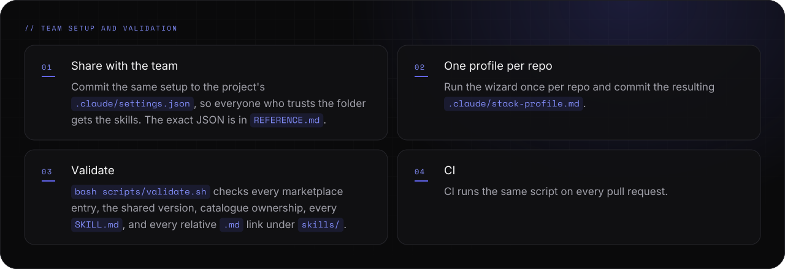
</picture>
</p>

<p>
<picture>
  <source media="(prefers-color-scheme: light)" srcset="assets/readme/reading-v2-light.svg">
  
</picture>
</p>

<p align="center">
<a href="REFERENCE.md"><picture><source media="(prefers-color-scheme: light)" srcset="assets/readme/links-1-v2-light.svg"></picture></a>
<a href="RATIONALE.md"><picture><source media="(prefers-color-scheme: light)" srcset="assets/readme/links-2-v2-light.svg">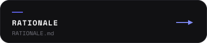</picture></a>
<a href="CONTRIBUTING.md"><picture><source media="(prefers-color-scheme: light)" srcset="assets/readme/links-3-v2-light.svg">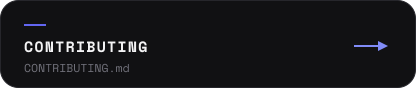</picture></a>
</p>

<p align="center">
<a href="skills/core/_shared/stack-profile.md"><picture><source media="(prefers-color-scheme: light)" srcset="assets/readme/links-4-v2-light.svg">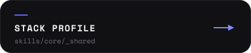</picture></a>
<a href="skills/core/_shared/tech-radar.md"><picture><source media="(prefers-color-scheme: light)" srcset="assets/readme/links-5-v2-light.svg">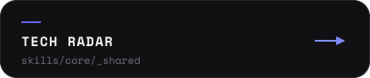</picture></a>
<a href="skills/core/_shared/security-baseline.md"><picture><source media="(prefers-color-scheme: light)" srcset="assets/readme/links-6-v2-light.svg">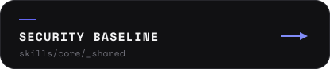</picture></a>
</p>

<p align="center">
<a href="skills/core/_shared/audience.md"><picture><source media="(prefers-color-scheme: light)" srcset="assets/readme/links-7-v2-light.svg">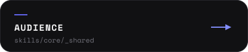</picture></a>
<a href="skills/frontend/_shared/architecture.md"><picture><source media="(prefers-color-scheme: light)" srcset="assets/readme/links-8-v2-light.svg">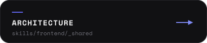</picture></a>
<a href="skills/frontend/_shared/fetcher.md"><picture><source media="(prefers-color-scheme: light)" srcset="assets/readme/links-9-v2-light.svg"></picture></a>
</p>

<p align="center">
<a href="skills/backend/_shared/service-layout.md"><picture><source media="(prefers-color-scheme: light)" srcset="assets/readme/links-10-v2-light.svg">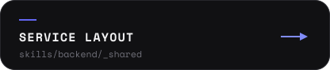</picture></a>
<a href="skills/landing/_shared/page-types.md"><picture><source media="(prefers-color-scheme: light)" srcset="assets/readme/links-11-v2-light.svg">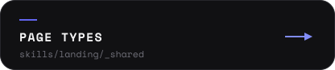</picture></a>
<a href="CHANGELOG.md"><picture><source media="(prefers-color-scheme: light)" srcset="assets/readme/links-12-v2-light.svg">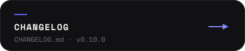</picture></a>
</p>

<p>
<picture>
  <source media="(prefers-color-scheme: light)" srcset="assets/readme/ops-v2-light.svg">
  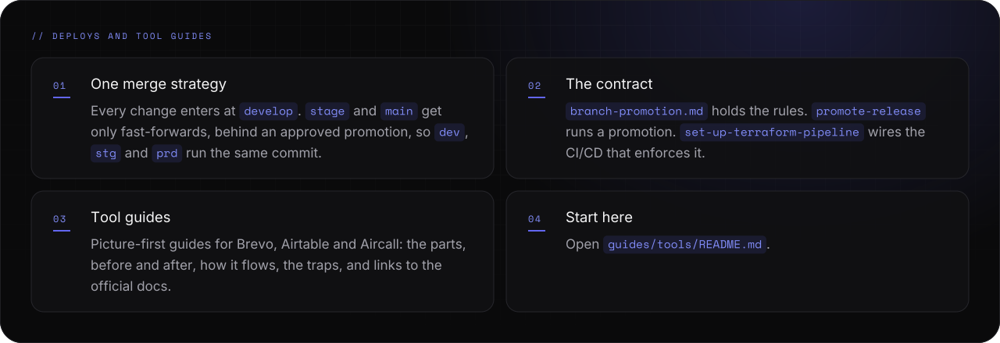
</picture>
</p>

<p align="center">
<a href="skills/core/_shared/branch-promotion.md"><picture><source media="(prefers-color-scheme: light)" srcset="assets/readme/links-17-v2-light.svg">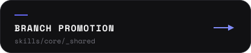</picture></a>
<a href="skills/core/promote-release/SKILL.md"><picture><source media="(prefers-color-scheme: light)" srcset="assets/readme/links-18-v2-light.svg">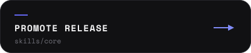</picture></a>
<a href="skills/infra/set-up-terraform-pipeline/SKILL.md"><picture><source media="(prefers-color-scheme: light)" srcset="assets/readme/links-19-v2-light.svg">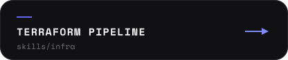</picture></a>
</p>

<p align="center">
<a href="guides/tools/README.md"><picture><source media="(prefers-color-scheme: light)" srcset="assets/readme/links-20-v2-light.svg"></picture></a>
</p>

<br>

<p>

</p>

<p>
<picture>
  <source media="(prefers-color-scheme: light)" srcset="assets/readme/status-v2-light.svg">
  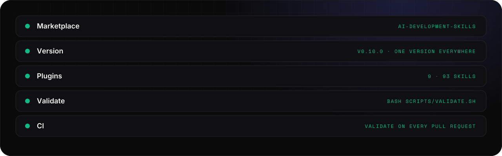
</picture>
</p>

<p>
<picture>
  <source media="(prefers-color-scheme: light)" srcset="assets/readme/release-v2-light.svg">
  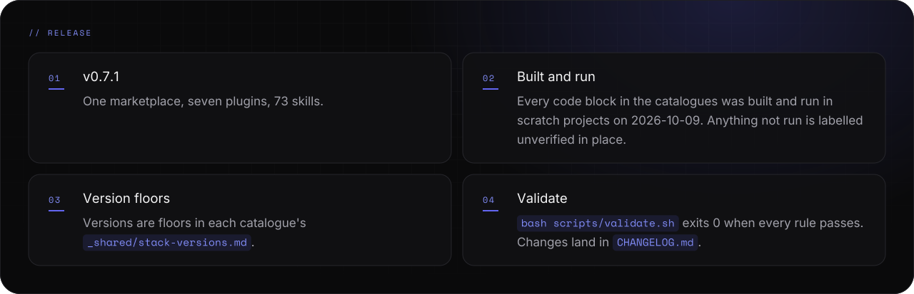
</picture>
</p>

<details>
<summary><picture><source media="(prefers-color-scheme: light)" srcset="assets/readme/links-16-v2-light.svg"></picture></summary>

```bash
bash scripts/validate.sh   # exit 0: every rule passes
```

</details>

<p align="center">
<a href="https://www.claude.com"><picture><source media="(prefers-color-scheme: light)" srcset="assets/readme/links-13-v2-light.svg">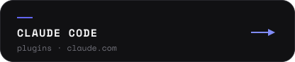</picture></a>
<a href="LICENSE"><picture><source media="(prefers-color-scheme: light)" srcset="assets/readme/links-14-v2-light.svg">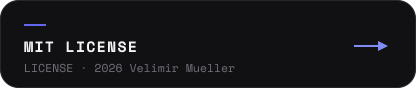</picture></a>
<a href="https://github.com/VelimirMueller"><picture><source media="(prefers-color-scheme: light)" srcset="assets/readme/links-15-v2-light.svg">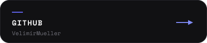</picture></a>
</p>

<p>
<picture>
  <source media="(prefers-color-scheme: light)" srcset="assets/readme/footer-v2-light.svg">
  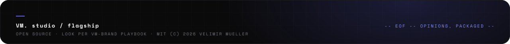
</picture>
</p>
