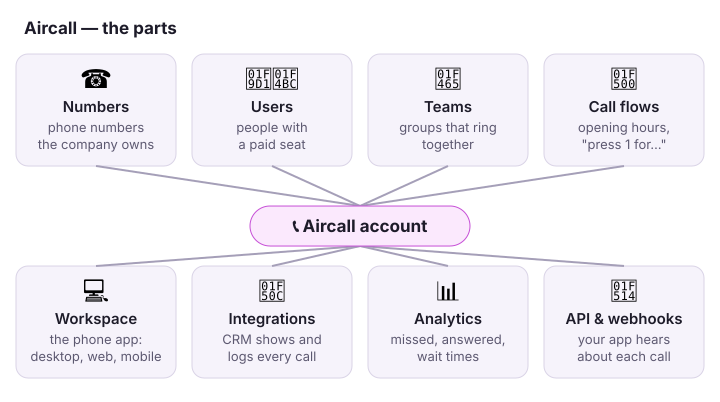
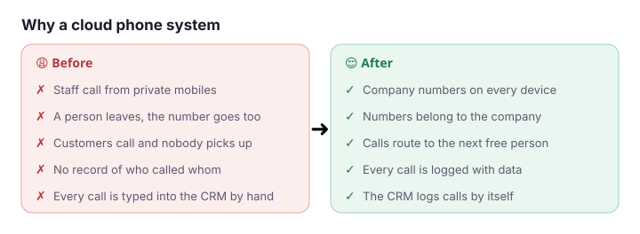
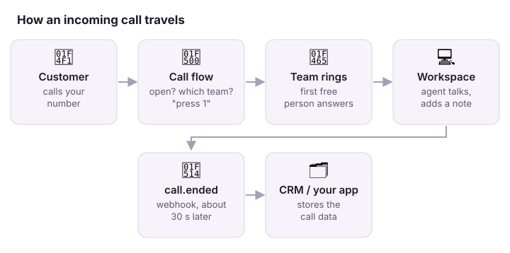
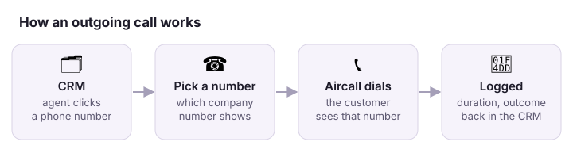

# 📞 Aircall

**Aircall is a phone system in the cloud. Company numbers ring in an app on the laptop, phone or browser.**

## In one minute

- ☎️ The company **owns the numbers**. People log in to the app and use them from any device.
- 🔀 A **call flow** decides who rings: opening hours, "press 1 for sales", which team.
- 🔌 Every call lands in the **CRM** (HubSpot, Salesforce, Pipedrive, Zendesk …) with its data.

## Before → after

## How it works

1. A customer calls your number.
2. The call flow checks the time and the menu choice, and picks a team.
3. The first free person answers in the **Workspace** app.
4. About 30 seconds after the call ends, Aircall sends `call.ended` with all the data.

## Words you will hear

| Word | In plain words |
|---|---|
| Licence / seat | One paid user. You pay per seat per month, also when that person does not call. |
| Number | A phone number Aircall rents to you. Local, national, mobile or toll-free. |
| Call flow / IVR | The rules for a number: "if closed, voicemail; press 1, sales team". |
| Ring strategy | All at once, or one after the other, in a team. |
| Power Dialer | Calls a list of people one after the other, no typing. |
| Local Presence | Shows the customer a number from their own area code, from the numbers you own. |
| Webhook | Aircall calls your URL when something happens (`call.created`, `call.ended` …). |

## Watch out

- ⚠️ **Local numbers need a local address.** Many countries (Germany too) give an area-code number only to someone located in that area.
- ⚠️ **`duration` is not talk time.** It runs from the first ring to the end. Talk time = `ended_at − answered_at`.
- ⚠️ **There is no "missed" flag.** A missed call has `status = done` and a `missed_call_reason`.
- ⚠️ **One API budget for the whole company:** 120 calls per minute. Do not poll — use webhooks.
- ⚠️ **Webhook events come twice or out of order.** Save by `call.id` and overwrite.
- ⚠️ **Recording links expire after a few hours.** Download when the event arrives. Recording needs consent by law.
- ⚠️ **Some data is in the US.** Check the data processing agreement before you sign.

## Do it

| I want to … | Where |
|---|---|
| Make an API key | Dashboard → Integrations & API → API keys (gives `api_id` + `api_token`) |
| Call the API | `https://api.aircall.io/v1/…` with Basic auth `api_id:api_token` |
| Start a call for a user | API `POST /v1/users/{id}/calls` with `number_id` and `to` |
| Hear about every call | Dashboard → Integrations & API → Webhook, pick the events |
| Change who rings when | Dashboard → Numbers → the number → Call distribution |
| See missed calls and wait times | Dashboard → Analytics |

## Go deeper

| Topic | Link |
|---|---|
| Developer portal (start here) | <https://developer.aircall.io/> |
| API reference (calls, users, numbers, webhooks) | <https://developer.aircall.io/api-references/> |
| Help centre (dashboard how-tos) | <https://support.aircall.io/> |
| Plans and prices | <https://aircall.io/pricing/> |
| German numbering rules (BNetzA) | <https://www.bundesnetzagentur.de/DE/Fachthemen/Telekommunikation/Nummerierung/start.html> |
