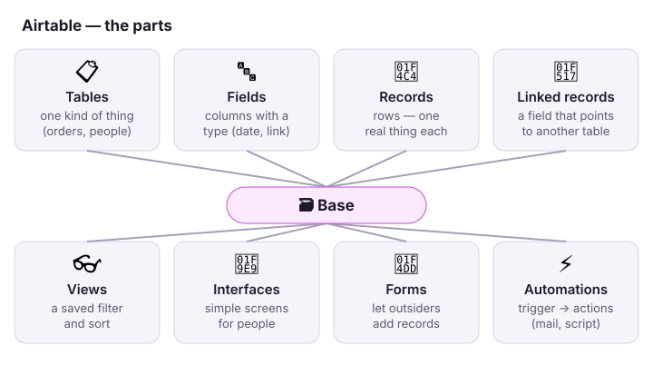
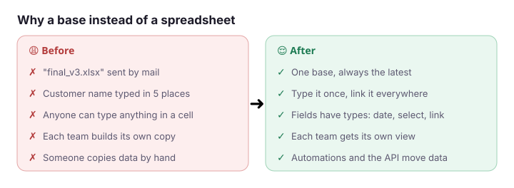
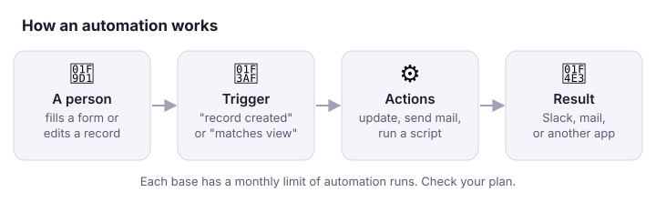
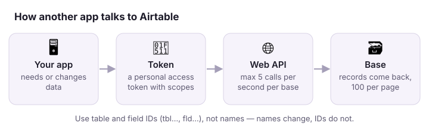

# 🗃️ Airtable

**Airtable is a database that looks like a spreadsheet. People click, apps talk to it through an API.**

## In one minute

- 🗃️ A **base** is one app: a set of tables that belong together (orders, customers, installers).
- 🔗 Tables **link** to each other, so a customer exists once and every order points to it.
- ⚡ **Automations** and the **API** move data in and out with no copy-paste.

## Before → after

## How it works

1. A person fills a form, or changes a record.
2. A **trigger** sees it ("record created", "record enters view").
3. **Actions** run: update a record, send a mail, post to Slack, run a script.

## Words you will hear

| Word | In plain words |
|---|---|
| Workspace | A folder of bases, with its own members and plan. |
| Base | One database. Has an id that starts with `app…`. |
| Table / field / record | Sheet / column / row. Ids start with `tbl…` / `fld…` / `rec…`. |
| Linked record | A field that points to records in another table. |
| Lookup / rollup | Show a value from a linked record / sum or count over linked records. |
| Formula | A field Airtable calculates. You cannot write to it. |
| View | A saved filter, sort and set of visible fields. Grid, kanban, calendar, form … |
| Interface | A simple screen built on a base, for people who should not see the raw tables. |
| Personal access token (PAT) | A key for the API. You choose its **scopes** and which **bases** it can open. |

## Watch out

- ⚠️ **Names change, ids do not.** Someone renames a field, and every script that uses the name breaks. Use `fld…` and `tbl…` ids.
- ⚠️ **5 calls per second per base.** Above that, the API answers `429` and you must wait 30 seconds.
- ⚠️ **10 records per write, 100 per read page.** Write in batches of 10. Read with the `offset` until it is empty.
- ⚠️ **Deleting a field breaks automations quietly.** The automation fails on its next run, not when you delete.
- ⚠️ **Plans have limits:** records per base, automation runs per month, history days. Check before you grow.
- ⚠️ **Interface-only users** cannot use the table API. They see only the screens shared with them.

## Do it

| I want to … | Where |
|---|---|
| Read records | API `GET https://api.airtable.com/v0/{baseId}/{tableId}` |
| Create or update up to 10 | API `POST` or `PATCH` on the same URL, `performUpsert` to match on a field |
| See the schema (tables, fields, ids) | API `GET /v0/meta/bases/{baseId}/tables`, or UI → Help → API documentation |
| Make a token | <https://airtable.com/create/tokens> |
| Hear about changes | API webhooks: `POST /v0/bases/{baseId}/webhooks` |
| Find why an automation failed | UI → Automations → the automation → Run history |

## Go deeper

| Topic | Link |
|---|---|
| Web API intro (start here) | <https://airtable.com/developers/web/api/introduction> |
| Rate limits | <https://airtable.com/developers/web/api/rate-limits> |
| Personal access tokens | <https://airtable.com/developers/web/guides/personal-access-tokens> |
| Webhooks | <https://airtable.com/developers/web/api/webhooks-overview> |
| Automations (help centre) | <https://support.airtable.com/docs/getting-started-with-airtable-automations> |
| Support (UI how-tos) | <https://support.airtable.com/> |
