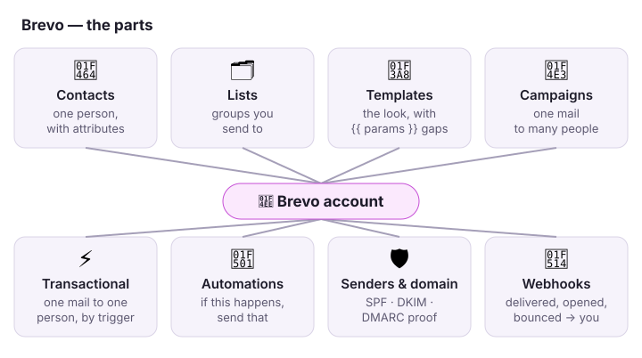
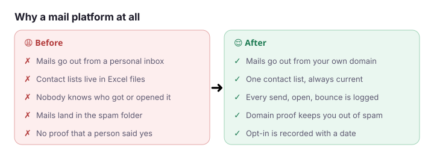
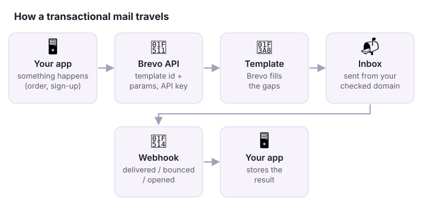
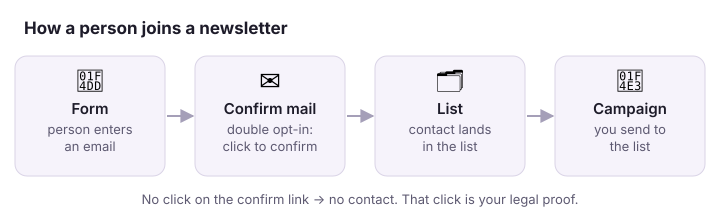

# 📮 Brevo

**Brevo sends email (and SMS) for you: newsletters to many people, and single mails your app triggers.**
Brevo was called Sendinblue until 2023.

## In one minute

- 📣 **Marketing:** you write one mail and send it to a list. People can unsubscribe.
- ⚡ **Transactional:** your app sends one mail to one person, for example "your order is confirmed".
- 🛡️ **Trust:** Brevo sends in your name only when your domain proves it is yours.

## Before → after

## How it works

1. Something happens in your app.
2. Your app calls the Brevo API with a **template id** and the **params** (name, order number).
3. Brevo fills the template and sends the mail from your domain.
4. Brevo tells your app what happened (delivered, bounced, opened) through a **webhook**.

## Words you will hear

| Word | In plain words |
|---|---|
| Contact | One person. Has an email and **attributes** (first name, city, any field you add). |
| List | A group of contacts you send to. One contact can be in many lists. |
| Segment | A list that fills itself from a rule ("city = Berlin"). |
| Template | The design of a mail, with gaps like `{{ params.firstName }}`. |
| Double opt-in (DOI) | The person must click a confirm link before they get newsletters. |
| Hard / soft bounce | Hard: the address does not exist. Soft: the inbox is full or the server is busy. |
| Blocklist | People who unsubscribed or bounced hard. Brevo does not send to them. |
| SPF · DKIM · DMARC | Three DNS records that prove to Gmail and Outlook that you may send for your domain. |

## Watch out

- ⚠️ **No domain proof, no inbox.** Without SPF, DKIM and DMARC, Gmail and Yahoo reject or spam-file bulk mail (rule since 2024).
- ⚠️ **Marketing and transactional are two separate worlds.** Each has its own logs, own blocklist and own stats.
- ⚠️ **An API key opens the whole account.** Keep it in a secret store. Turn on "authorised IPs" so a leaked key is useless elsewhere.
- ⚠️ **Test without sending.** For a test call, add the header `X-Sib-Sandbox: drop`. Brevo checks the call and sends nothing.
- ⚠️ **A contact is not a customer record.** Brevo holds what mail needs. Your CRM or database stays the source of truth.

## Do it

| I want to … | Where |
|---|---|
| Send one mail from code | API `POST https://api.brevo.com/v3/smtp/email`, header `api-key` |
| Add or update a contact | API `POST /v3/contacts` with `updateEnabled: true` |
| See why a mail did not arrive | UI → Transactional → Logs, search the address |
| Prove the domain | UI → Senders, Domains & Dedicated IPs → Domains → Authenticate |
| Get events in my app | UI → Transactional → Settings → Webhook, or API `POST /v3/webhooks` |

## Go deeper

| Topic | Link |
|---|---|
| Developer docs (start here) | <https://developers.brevo.com/> |
| API reference (every endpoint) | <https://developers.brevo.com/reference> |
| Send a transactional mail | <https://developers.brevo.com/docs/send-a-transactional-email> |
| Webhooks | <https://developers.brevo.com/docs/how-to-use-webhooks> |
| Help centre (UI how-tos) | <https://help.brevo.com/> |
| Gmail sender rules (why SPF/DKIM/DMARC) | <https://support.google.com/a/answer/81126> |
| DMARC explained | <https://support.google.com/a/answer/2466580> |
| Sandbox mode (test without sending) | <https://developers.brevo.com/docs/using-sandbox-mode-to-send-an-email> |
